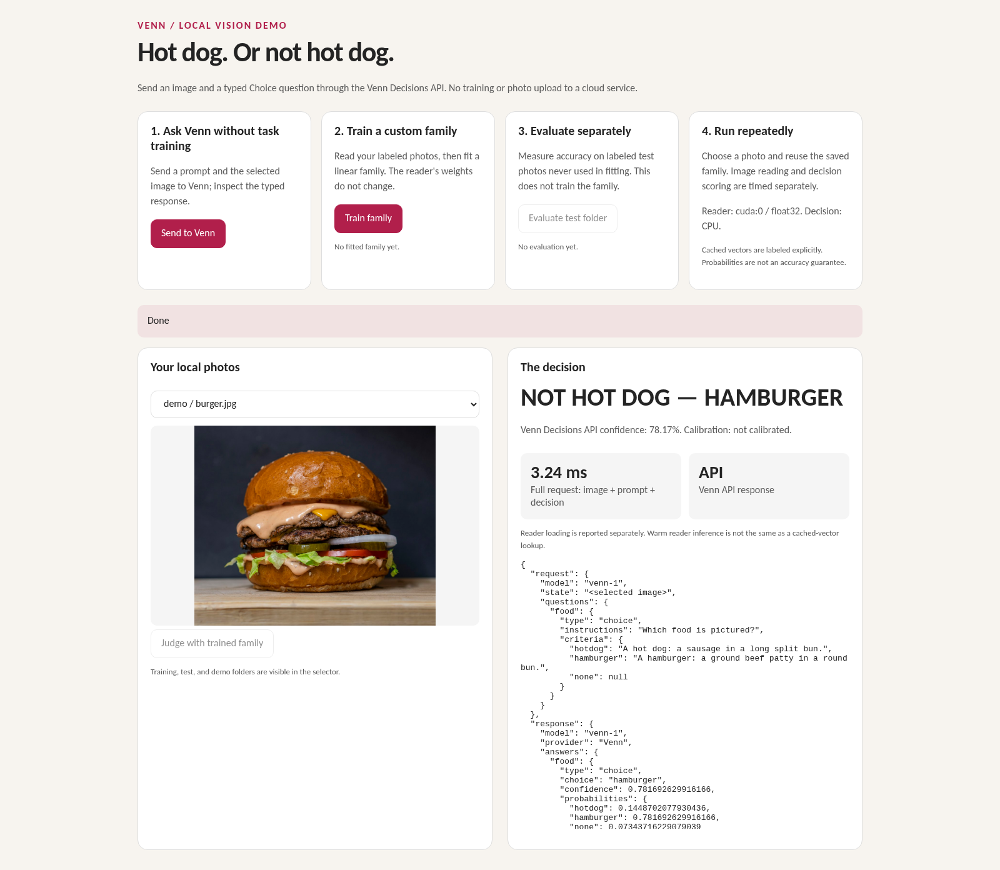
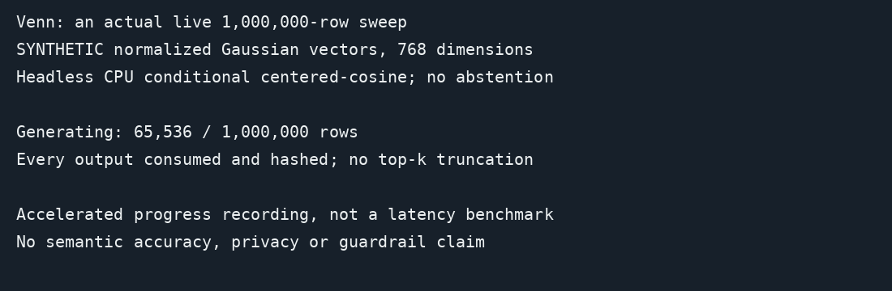

# Demos and videos

<!-- docs-navigation:start -->
[Documentation](README.md) · [Get started](getting-started.md) · [Concepts](concepts.md) · [Venn vs Jev](venn-and-jev.md) · [Examples](../examples/README.md) · [Task recipes](cookbooks.md) · [Adapters](adapters.md) · [API](api.md) · [Results](evidence.md)

<details>
<summary>Browse all documentation</summary>

**Project home:** [Home](../README.md)

**Start here:** [Documentation overview](README.md) · [Getting started](getting-started.md) · [Installation](installation.md) · [Concepts](concepts.md) · [Venn vs Jev](venn-and-jev.md)

**Task guides:** [Task recipes](cookbooks.md) · [Store adapters](adapters.md) · [Outcome stores](outcome-api.md)

**Examples:** [Choose an example](../examples/README.md) · [Hot dog image classifier](../examples/hotdog/README.md) · [Precedent Desk](../examples/precedent_desk/README.md) · [Wine predictor](../examples/wine/README.md) · [Audio classifier](../examples/audio/README.md) · [Screen-only arena](arena-example.md) · **Demos and videos**

**Reference:** [API reference](api.md) · [Design rationale](design.md) · [Venn 1 model card](model-card.md)

**Results and limits:** [Performance and cost](performance.md) · [VennSpace-1](benchmark.md) · [Results and evidence](evidence.md) · [Reproduction](reproduction.md) · [Semantic boundary findings](redteam.md) · [Limitations](limitations.md) · [Comparison video methods](same-memory-video.md) · [Comparison notebooks and renderer](../examples/same_memory_video/README.md)

**Project:** [Policies](policies.md) · [Licenses and attribution](licenses.md) · [Contributing to Venn](../CONTRIBUTING.md)

**Maintainers:** [Maintainer guide](maintainers/maintaining.md) · [Documentation site](maintainers/website.md) · [Release checklist](maintainers/release-checklist.md) · [Publishing the Python package](maintainers/pypi.md) · [Publishing the decision head](maintainers/publishing-the-head.md) · [Development evidence](maintainers/development-evidence.md) · [Comparative evaluation protocol](maintainers/evaluation-plan.md) · [License audit notes](maintainers/license-audit.md)

</details>

**Examples / Demos and videos**
<!-- docs-navigation:end -->

<!-- docs-contents:start -->
<details>
<summary>On this page</summary>

- [Choose a demonstration](#choose-a-demonstration)
- [Local image classifier](#local-image-classifier)
- [Screen-only arena video](#screen-only-arena-video)
- [Decisions over stored embeddings](#decisions-over-stored-embeddings)
- [Precedent Desk video](#precedent-desk-video)
- [Retrieval, drift and collection demos](#retrieval-drift-and-collection-demos)
- [Live local documentation and playground](#live-local-documentation-and-playground)
- [Arena footage and measurement details](#arena-footage-and-measurement-details)

</details>
<!-- docs-contents:end -->

[](../examples/hotdog/README.md)

[Hot dog image demo](../examples/hotdog/README.md): training-free burger judgment using Gemma image and text embeddings. See
the example for the comparison, earlier classifier failure, setup and photo credit.

## Choose a demonstration

| Demonstration | What to look for | Run it |
| --- | --- | --- |
| Hot dog image classifier | Train a small classifier on local photos, evaluate unseen photos, then inspect image-reading and decision timings | [Local image demo](../examples/hotdog/README.md) |
| Screen-only arena | Actions chosen from past outcomes, then a head compiled from that memory | [Arena application](arena-example.md) |
| Precedent Desk | Ticket routing from resolved history, with precedents and a backlog sweep | [Support-ticket application](../examples/precedent_desk/README.md) |
| Wine predictor | A numeric family fitted and evaluated through the same API | [Wine example](../examples/wine/README.md) |
| Audio classifier | A linear family trained from labeled WAV clips | [Audio example](../examples/audio/README.md) |

The image and audio examples use data supplied locally; they are workflow
examples, not general accuracy benchmarks. Each guide lists its downloads,
setup and evaluation boundaries. For all scripts, including the download-free
outcome example, see the [example catalog](../examples/README.md).

## Local image classifier

[Hot dog or not](../examples/hotdog/README.md) is a small browser application for
learning a two-label visual decision from personal photos. It separates training,
held-out evaluation and repeated prediction. The embedding reader stays frozen;
Venn fits a linear family and keeps it for later requests. Use the separate
training and test folders to inspect how it handles genuinely unseen examples.

This complements the arena's learning-from-outcomes story and the wine example's
numeric predictor: the same family API can support a local image classifier.
The guide explains CPU/GPU setup and how to distinguish fresh image embedding,
cached-vector lookup and decision timing.

## Screen-only arena video

<!-- video: venn-arena -->

https://github.com/user-attachments/assets/42b3ddeb-0c9a-42f3-ad5a-e1d9d8734088

The video also has a [release download](https://github.com/markrussinovich/venn-vdm/releases/download/media-v1/venn-arena.mp4); the poster, captions and
provenance files live in this folder.

The 112-second video shows a player that sees only the screen learning a
ViZDoom level through Venn's outcome API, and then the small head compiled
from that player's memory. The game client sends batches of screenshots to
`OutcomeService`; Venn embeds them with EmbeddingGemma 2, looks up how similar
moments turned out for each move in the client's FAISS store, and returns the
move with the best recorded outcome. When a game ends, the client writes its
returns back to the store. The reader is never trained; the memory holds
everything the player learns. In the last third, one more call
(`register_family`) compiles the memory into a rank-16 bilinear head of 49,153
parameters, and the same question, now naming the family, is answered by the
head alone with the memory switched off.

| What the video compares | Result |
| --- | --- |
| Compiled head, memory switched off | 8.4 kills/game |
| Outcome memory | 6.2 kills/game |
| Evaluation | Five memories, 50 fresh games each: 250 games per method |

The featured head-only game was selected for smooth play and scored 13 kills;
it is not the average result. See [footage and measurement details](#arena-footage-and-measurement-details)
for clip selection, timing boundaries and replay verification.

[Run the arena application](arena-example.md), review the
[storyboard](media/venn-arena-storyboard.png), download the
[captions](media/venn-arena-captions.srt), or inspect the
[provenance manifest](media/venn-arena-manifest.json) for every number and
clip. Freedoom assets retain their [license](media/freedoom-copying.txt) and
[credits](media/freedoom-credits.txt). Original checkpoints and raw experiment
archives are not included.

## Decisions over stored embeddings

<!-- video: venn-same-memory-review -->

https://github.com/user-attachments/assets/ae29eb8c-ee45-46d1-b21c-9b6d9689ccf5

A 2:30 companion to the arena video, plus a 1:00 vertical cut: complaints,
filing conventions and wine prediction, with more reading time for the technical
explanations. **Available to repository members through the private release; public launch
is pending.**
The [dedicated video and methods page](same-memory-video.md)
references each source demo, the numeric notebooks and the failed gates.
SEC remains inconclusive; the wipe is conceptual; no source narratives,
tasting notes or speech playback are included.

## Precedent Desk video

<!-- video: venn-precedent-desk -->

https://github.com/user-attachments/assets/8a718a42-27b0-482f-8b34-4d00d8836d69

A support desk whose closed tickets are the model, recorded from the live
[Precedent Desk example](../examples/precedent_desk/README.md) in five
segments: Jev and Venn without history on the same ticket stream; the closed
tickets attached, with the precedents beside every answer and the history
slider; one embedding answering routing, precedents and queue fit; two backlog
sweeps, the registered question and the 77-queue re-tag, each labelled; and
the negation ticket with a live Jev call and the composition rule. Every
accuracy on screen is read from `eval.py` results; the routing, precedents,
queue-fit flag, sweeps and the Jev calls are live. The desk is played by
Banking77 (CC BY 4.0); Jev 1.13 answers come from a matched run on the same
3,080 test tickets through OpenRouter. The [captions](media/precedent-desk-captions.srt),
[storyboard](media/precedent-desk-storyboard.png) and
[manifest](media/precedent-desk-manifest.json) are in this folder.

## Retrieval, drift and collection demos

These are illustrations, not benchmark accuracy or safety claims.
Install `.[embedding,benchmark]` for the combined runner. The RAG control,
labels, topic policy and drift horizon are fixed in the
public source before embedding; all texts were authored for these examples.

```bash
venn demos --output /tmp/venn-demos --cache /tmp/venn-cache.sqlite --gpus 1
```

The million-row sweep uses explicitly synthetic normalized Gaussian vectors
in a temporary float16 memory map, not a million real Gemma documents.
The default is a headless CPU conditional centered-cosine sweep. To exercise
the actual trained-head `DecisionService` index registration and streaming
implementation (one prepared question applied to every vector in a
registered index, streamed as NDJSON), additionally supply `--model-dir` with
the path printed by `venn download-model`. It consumes every NDJSON batch,
counts every row and hashes all serialized output. Generation, index
registration, scoring/serialization/consumption and end-to-end times are
separate; model/service loading is excluded. The combined runner requires the
pinned reader and CUDA even with `--rows 1000`. For a standalone CPU smoke
test, use `venn sweep --rows 1000`; it downloads no reader and loads no head.
Temporary vectors are deleted.



The animation records actual generation and full output consumption of the
headless million-row path, accelerated for viewing. It is not a real-time
latency comparison or a recording of a million real documents. Recreate it
with `python scripts/record_sweep.py --output /tmp/million-sweep.gif`.

RAG retrieves six passages before filtering; afterwards it retains passages
assigned to the account-access topic by centered-cosine conditional Choice.
Relevance labels and the untouched before control are included; precision,
recall and returned count are reported, including empty results. No answer
generation or downstream hallucination claim is made.

Drift compares eight 48-row windows against a fixed account-support reference.
Windows four through seven switch to shipping. The finite eight-window
Bonferroni policy uses alpha .05/8 and 199 permutations. The repeated authored
texts are an illustration, not independent samples or an unlimited sequential
false-alarm guarantee. P-values are not probabilities of drift.

## Live local documentation and playground

```bash
pip install -e '.[embedding,benchmark,dev]'
python scripts/build_site.py --output /tmp/venn-site
venn serve --site-dir /tmp/venn-site
```

`venn serve` downloads the published head on first start unless `--model-dir`
or `VENN_MODEL_DIR` points at an existing copy. Open
`http://127.0.0.1:8000/guide/` and `/playground`. The playground executes
nearest-reference, k-NN outliers, population shift and actual indexed NDJSON
streaming. Its built-in examples disclose synthetic vectors. A local JSON
store can replace the example index; upload only vectors from the exact
pinned profile. The demo has no authentication and binds loopback by default;
do not expose it directly on the internet.


## Arena footage and measurement details

**Footage.** Four recorded episodes are replayed tic by tic in ViZDoom from
their recorded actions. The opening pair is scored episode 1 of the development
run twice: first with an empty memory, ending with 1 kill, then with the memory
after 431,173 decisions, from the same seed and starting position. The memory
round in the middle is scored episode 8 with that same memory, which ends with
6 kills. The head-only round is scored game 5 of 50 for the fourth research
memory, played by the head compiled from that memory with no lookup; it is
shown continuously from its start and ends with 13 kills, after which the
player has spent all 26 rounds and the recording stops. It was chosen for
smooth play; the best of those 50 games scored 15, and their mean was 8.6. To
obtain its frames, all 50 games of that evaluation were re-run through the
same service and every kill count, score and tic count matched the recorded
evaluation before the one game was replayed. Every decision-boundary frame
hash and all four final scores were checked, so the footage is the recorded
gameplay at full frame rate rather than a new run. The memory round contains
one jump cut, so that the end of the round is shown. The 128-game
montage cross-fades 24 recorded composite snapshots of the training games; the
green outlines the snapshot tool drew around the eight always-greedy games are
painted out, and the caption explains that the learning curve follows those
eight games.

**Numbers.** The average over the 50 scored games of the development run is
6.18 kills. In the comparison chart, the head's 8.4 comes from the head study:
five independent memories of 431,173 decisions each, a head compiled from each
with the advantage-weighted imitation objective, and 50 fresh games per memory
served by the head alone and by the memory alone, 250 games each, with heads
and memories frozen. The head beat its memory on all five, by 2.2 kills with a
paired 95% interval of [1.5, 2.9]. The chart's memory bar is drawn at 6.17,
from the earlier study of five runs with 50 games each that built those
memories; the head study's same-day memory control measured 6.20, and both
round to the 6.2 on screen and in the caption. The 4.9 for a raw-pixel memory
and 1.3 for random moves come from that earlier study too, and the small
learning curve is the online average across its five runs. The
[arena example](arena-example.md#compile-the-memory-into-a-head) gives both studies'
tables. The head's size is its parameter count and the size of
the saved file. The speed figures, 94.7 decisions a second and 1.35 seconds
per batch of 128 screens, are medians for the warm full loop on one A100,
including the game itself. The slow-motion segment shows one recorded case per
move with its rounded outcome score, which is what the exact-match convention
returns for a screen that is already in memory, and its gunshots are placed at
the replayed shot tics slowed to a quarter speed. The bars beside the
head-only round are the head's scores for the three moves, shown as shares.

**Sound.** The effects are Freedoom's own sound lumps, placed at the replayed
tics where the pistol fired, an enemy died or the player took damage. The
music is a generated synth pad with no third-party material.

<!-- docs-pager:start -->
---

[← Previous: Screen-only arena](arena-example.md) · [Next: API reference →](api.md) · [Documentation home](README.md)
<!-- docs-pager:end -->
