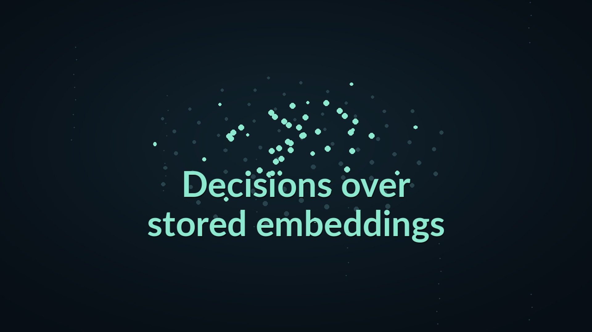
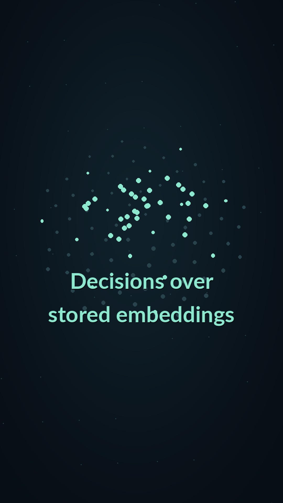

# Decisions over stored embeddings

<!-- docs-navigation:start -->
[Documentation](README.md) · [Get started](getting-started.md) · [Concepts](concepts.md) · [Venn vs Jev](venn-and-jev.md) · [Examples](../examples/README.md) · [Task recipes](cookbooks.md) · [API](api.md) · [Results](evidence.md)

Browse all documentation

**Project home:** [Home](../README.md)

**Start here:** [Documentation overview](README.md) · [Getting started](getting-started.md) · [Installation](installation.md) · [Concepts](concepts.md) · [Venn vs Jev](venn-and-jev.md)

**Task guides:** [Task recipes](cookbooks.md) · [Outcome stores](outcome-api.md)

**Examples:** [Choose an example](../examples/README.md) · [Hot dog image classifier](../examples/hotdog/README.md) · [Precedent Desk](../examples/precedent_desk/README.md) · [Wine predictor](../examples/wine/README.md) · [Audio classifier](../examples/audio/README.md) · [Screen-only arena](arena-example.md) · [Demos and videos](demos.md)

**Reference:** [API reference](api.md) · [Design rationale](design.md) · [Venn 1 model card](model-card.md)

**Results and limits:** [Performance and cost](performance.md) · [VennSpace-1](benchmark.md) · [Results and evidence](evidence.md) · [Reproduction](reproduction.md) · [Semantic boundary findings](redteam.md) · [Limitations](limitations.md) · **Comparison video methods** · [Comparison notebooks and renderer](../examples/same_memory_video/README.md)

**Project:** [Policies](policies.md) · [Licenses and attribution](licenses.md) · [Contributing to Venn](../CONTRIBUTING.md)

**Maintainers:** [Maintainer guide](maintainers/maintaining.md) · [Documentation site](maintainers/website.md) · [Release checklist](maintainers/release-checklist.md) · [Publishing the Python package](maintainers/pypi.md) · [Publishing the decision head](maintainers/publishing-the-head.md) · [Development evidence](maintainers/development-evidence.md) · [Comparative evaluation protocol](maintainers/evaluation-plan.md) · [License audit notes](maintainers/license-audit.md)

**Results and limits / Comparison video methods**
<!-- docs-navigation:end -->

<!-- docs-contents:start -->

On this page

- [What each beat references](#what-each-beat-references)
- [History: an outcome, not just a label](#history-an-outcome-not-just-a-label)
- [SEC: show the result and the failed gate](#sec-show-the-result-and-the-failed-gate)
- [Wine: accuracy and work are separate measurements](#wine-accuracy-and-work-are-separate-measurements)
- [Archived assets and source credits](#archived-assets-and-source-credits)
- [Scoreboard and claim limits](#scoreboard-and-claim-limits)
- [Recompose and verify](#recompose-and-verify)
- [Release checklist](#release-checklist)
- [Production notes](#production-notes)

<!-- docs-contents:end -->

**Private release preview, November 7, 2026. Clearances granted; public launch on hold.**
This companion to the [screen-only arena video](demos.md#screen-only-arena-video)
asks what business records remember about similar cases. It shows how historical outcomes, learned filing conventions and fitted
predictors change what an application can answer. There is no narration.

Read the [Venn and Jev guide](venn-and-jev.md) for the project comparison.
Jev supports text and images; it does not return embeddings or use embedding
history. The text-only Jev scenes here show the
inputs used in these examples.

**What this video explains:** how Venn differs from Jev, and why that matters.
Jev is TypeSafe's decision model: supply an input, a typed question and
possible answers, and it returns a selection with probabilities. This follows
TypeSafe's [System One description](https://docs.typesafe.ai/concepts/system-one.md)
and [Choice interface](https://docs.typesafe.ai/primitives/choice.md), not a
generic chatbot diagram. Jev also supports images; the comparisons in this
video use text, not all of Jev's input modalities.
Venn encodes the input, question and choices and uses a small decision head
to score the choices. It can work from stored
embeddings: similar cases supply historical outcomes, labeled examples train
task-specific heads, and cached vectors avoid repeating text-question pipelines.
These are different
information and execution paths, not a claim that one model wins every task.

[Download landscape, 2:30](https://github.com/markrussinovich/venn-vdm/releases/download/media-v1/venn-same-memory-review.mp4) ·
[English captions](media/venn-same-memory-review-captions.vtt) ·
[Storyboard](media/venn-same-memory-review-storyboard.png)

[Download vertical, 1:00](https://github.com/markrussinovich/venn-vdm/releases/download/media-v1/venn-same-memory-vertical-review.mp4) ·
[English captions](media/venn-same-memory-vertical-review-captions.vtt) ·
[Storyboard](media/venn-same-memory-vertical-review-storyboard.png) ·
[Provenance and edit manifest](media/venn-same-memory-manifest.json)

The draft contains our own Jev measurements and answers. Publication warnings,
provisional disclosures, credits and technical qualifications live **on this
page, not as fine print over the video**. It is not the published-numbers-only fallback. No source
complaint narrative, tasting note or speech recording is played or printed.
The owner confirmed clearances on November 7 and authorized attaching both
cuts to the private repository's `media-v1` release. The MP4s are now attached
there, with supporting files in Git. Repository visibility remains private;
public launch is still on hold. Release downloads require access to the private
repo until launch. The site builder uses local MP4s when available and the
release URLs otherwise.

## What each beat references

| Time | Demo and source | Check the video numbers | Run the related Venn interface |
| --- | --- | --- | --- |
| 0:00–0:24 | Setup, Jev's question-and-choice interface, then Venn's reader and head | Authored schematic, not a benchmark | [Jev Choice](https://docs.typesafe.ai/primitives/choice.md), [Venn concepts](concepts.md) |
| 0:24–0:57 | History: [MotherDuck's CFPB example](https://motherduck.com/blog/jev-for-analytics/) and [CFPB complaint data](https://www.consumerfinance.gov/data-research/consumer-complaints/) | [History notebook](../examples/same_memory_video/history.ipynb), [eval file](media/same-memory/history-eval.json) | [Outcome-store example](../examples/outcome_store.py), [outcome API](outcome-api.md) |
| 0:57–1:29 | Conventions: TypeSafe's [classification-with-confidence cookbook](https://docs.typesafe.ai/cookbooks/classification_using_confidence) | [SEC notebook](../examples/same_memory_video/sec.ipynb), [eval file](media/same-memory/sec-eval.json) | [Linear-family cookbook](cookbooks.md#fit-a-linear-choice-family), [family lifecycle example](../examples/registered_family.py) |
| 1:29–2:23 | Work: TypeSafe's [wine feature-discovery cookbook](https://docs.typesafe.ai/cookbooks/autoresearch_feature_discovery) | [Wine notebook](../examples/same_memory_video/wine.ipynb), [eval file](media/same-memory/wine-eval.json), [executed registration](../examples/same_memory_video/head_demo.py) | [Runnable wine demo](../examples/wine/README.md), [kernel-ridge recipe](cookbooks.md#fit-a-numeric-family) |
| 2:23–2:30 | Scoreboard, limitations and close | [Evidence](evidence.md), the beat notebooks and limitations below | [Install](getting-started.md), [Precedent Desk](../examples/precedent_desk/README.md) |

These are related interfaces, not claims that the small synthetic examples
reproduce the research studies. The runnable wine demo defaults to the ridge baseline; select
`--form kernel_ridge` for the SentenceSimilarity-plus-length configuration.
It evaluates the cookbook's 800-note split, not the additional 3,000-note
comparison. The separate cookbook documents the registration call. No public end-to-end SEC or CFPB research runner
is implied by these links.

## History: an outcome, not just a label

The label-rate baseline applies MotherDuck's published *method* to a different
population. It is not MotherDuck's own published AUROC, nor a direct Jev
prediction of monetary relief. Jev assigns a requested-outcome label; the
baseline returns the historical monetary-relief rate for that label. Venn
returns the raw rate among similar same-company cases, with a product fallback
when support is insufficient. Neither raw rates nor AUROC establish calibrated
individual probabilities.

On the primary population, within-company AUROC is **0.702 versus 0.768**.
Among refund requests it is **0.500 versus 0.644**. The test period is April
2023 through December 2024, 21 months excluded from the archive, with a 90-day
gap. The primary and novel-stratum improvement gates passed. The eval file
retains their recorded intervals and gate result; the notebook recomputes
point estimates from anonymous company/label/score count histograms, preserving
ties and company weights. Bootstrap intervals are not rerun by that notebook.

**Example rule.** The hero is the original pre-evaluation NIST-beacon draw,
not a success selected for the video. The scatter shows 180 evenly spaced
complaint IDs from that company's scored test complaints, plus the hero if
absent. IDs, company identity and narratives are omitted from this export.
Dot heights are layout positions, not another measured quantity. Colors show
actual outcomes; the marked complaint received **no monetary relief**. Its five
nearest displayed precedents include one relief outcome, but its prediction
uses the full selected neighborhood, not just these five.

The wipe is explicitly **conceptual**. Dots collapse to a common line to
illustrate loss of ranking evidence. No empty-store service result or measured
0.50 AUROC is claimed. A constant ranking would have 0.50 AUROC by construction
where both classes exist; that does not prove the API returns a coin flip.

The opening uses the authored Choice example and makes no MotherDuck
throughput claim. The video's "Ranking quality (higher is better)" is the
within-company AUROC documented above, not the percentage of complaints
correctly classified.

## SEC: show the result and the failed gate

On TypeSafe's 60 filings, the Jev rerun got **40** groups right and Venn's
linear family **46**. The one-sided paired p-value is **0.09**: the primary
accuracy gate failed, as did the useful-answer gate. On 1,000 additional,
unfiltered filings, group accuracies were **64.1% and 73.3%**. That confirmation
is report-only under the original protocol, not a replacement passing gate.
This page retains both facts; the video does not list SEC as a demonstrated win.
The cookbook's own published Jev result was 39/60.

**Example rule.** Filing `23082_2004` was specified editorially in the brief;
it was not randomly drawn. The cached SEC company lookup identifies it as
**COMPUTER SCIENCES CORP**, SIC 7373. Jev selected engineering services with
97% confidence; Venn selected the filed Business Services group. The retrieved
neighbors are Techteam Global, Perot Systems, Digitalnet Holdings, Dyntek and
Covansys, all in group 73. Their names are metadata, not reproduced filing text.

This strip illustrates retrieval from the same archive. It is **not a causal
explanation of the linear head's prediction**. Training labels explicitly
supply the filing convention, so the draft does not say "Nobody told Venn."
The division breakdown was post hoc; the retail/wholesale observation is not
promoted to a separately tested general claim.

## Wine: accuracy and work are separate measurements

Revision 2 passed **G1**, not G2. On 3,000 fresh notes, Venn scored
**1.803 RMSE** versus our five-round pipeline rerun's **1.794**, inside the
predefined 2% point-estimate rule. The ratio's 90% interval was
0.983–1.026; G1 is not an equivalence confidence-interval test. G2's equivalence
interval on the 800-note second look was too wide and failed. Revision 1's
failed results are not overwritten.

On screen, these results are labeled **"Prediction error in score points"**,
with **1.79** for Jev and **1.80** for Venn and an explicit **"Lower is better"**.
The underlying measure is root mean squared error, rounded to two decimals;
it is not mean absolute error. The acronym remains in the notebook and
methods, not in the video.

The **31-second** Venn build includes embedding 1,200 fitting notes and family
selection/fitting on one A100. The **17.4-minute** Jev comparison is a separate
live five-round discovery run that ended with 35 questions; it is **not a
timing of the published 38-question pipeline**. This page identifies it as a
separate historical run. These figures are not a controlled hardware-only
speed comparison.

The timing card is headed **"Build a score predictor"**, with the fitting-note
count scoped to Venn and an explicit embedding-included caption. The later
**"Predict prices across the inventory"** card describes a different job,
shows the inventory size and says Venn's time excludes the already-completed
embedding step. These are not consecutive stages of one benchmark.

The published-numbers-only alternative is **Venn 1.765 versus TypeSafe's
published 1.772 on 800 notes**, labeled as a second look. It omits our Jev
rerun figures and timings; it was prepared while they awaited clearance. The
owner cleared them for publication on November 6, 2026.

**New question: price.** On all **65,701** notes, with embeddings already
stored, the Venn regression family took **3.29 seconds to train and 3.57 to
predict**, about **7 seconds** combined, with **no API charge**. This is not
zero local compute cost. Embedding the whole file was a separate, once-paid
76-second A100 pass.

**Vector reuse qualification.** Price uses Phase 14c's already-cached
Classification-prompt vectors. The winning revision-2 score head uses
SentenceSimilarity-prompt vectors plus length features. These are **not the
same vector cache**. This transition demonstrates another question on stored
vectors, not a measured price head on the winning score head's exact vectors.
This page identifies the price prompt explicitly; a literal same-vectors cut
would need an additional evaluation, not an assumption.

Jev direct took approximately **30 minutes** and **$1.26** for price. The
timing is scaled from the final measured portion after a credit interruption;
all answer costs are summed. Two endpoint passes ran concurrently, so observed
latency includes shared capacity. The fresh price pipeline adds discovery and
took about **53 minutes**, around **$13**; the roughly 1.5-hour figure applies
to the fresh **variety** pipeline, not price.

Price accuracy was tested on held-out notes, **not the whole inventory**:
Venn's log-price RMSE was 0.538 versus 0.531 for the Jev arm selected on dev.
The paired 90% interval was inside the predefined equivalence margin. The
inventory sweep measures work; it does not create another accuracy test.
The draft replaces the old 145-second/9-second comparison with these measured
whole-file timings, excluding embedding on Venn's new-question path.

## Archived assets and source credits

The removed audio beat's [notebook](../examples/same_memory_video/sound.ipynb)
and [eval file](media/same-memory/sound-eval.json) remain as provenance for
earlier drafts. They are not loaded by the current renderer or represented in
either cut's results. Their historical results and example-selection rule are
unchanged.

**Credit and rights.** CREMA-D: Cao, Cooper, Keutmann, Gur, Nenkova and Verma
(2014), [source and license information](https://github.com/CheyneyComputerScience/CREMA-D),
[ODbL 1.0](https://opendatacommons.org/licenses/odbl/1-0/) and
[DbCL 1.0](https://opendatacommons.org/licenses/dbcl/1-0/).
The exported waveform envelopes are derived CREMA-D database contents and
retain those terms; they are not covered by the repository's code license.
No intelligible speech audio is included. Playback clearance, or replacement
recordings from consenting speakers, is still needed for a spoken version.

Wine data is credited to Wine Enthusiast via the pinned
[GroNLP winemag dataset](https://huggingface.co/datasets/GroNLP/ik-nlp-22_winemag)
(CC BY-SA 4.0 as declared there). No tasting notes are redistributed here.

## Scoreboard and claim limits

Jev wins the recorded grape-identification comparison and described-queue bug
routing comparison; Venn's history does not universally beat reading the item.
The scoreboard cites those failures without adding unmeasured "brand-new
categories" or post-hoc division claims. History-based outcome ranking,
price with less work are the positive cases. SEC remains
inconclusive at its original gate. "Same typed questions" describes interface
and task families, not identical information available to both systems or
proof that a Jev application cannot also use an external archive.

The close invites the viewer to build decisions from their own data. It does
not add a blanket superiority claim. Jev and TypeSafe are named in text, not
logos or the poster.

## Recompose and verify

See the [renderer and notebook instructions](../examples/same_memory_video/README.md).
The three active notebooks recompute point estimates from curated numeric exports.
They do **not** rerun the original experiments, remeasure timings, independently
verify bootstrap intervals or resolve publication rights. The manifest hashes
the exact exported eval files and both MP4s. Narratives, raw vectors, model
checkpoints, API credentials and original experiment archives are not included.

All text is safe-area and overlap checked by the renderer; story captions have at most
eight words and frames at most three numeric values. No rendered text is
smaller than 48 pixels at the final 1080-wide/high output scale. Animated records are
schematic; scatter positions use recorded scores.
The workflow lanes are diagrams. The separate code replay shows the exact
`register_family` call inside `head_demo.py`'s `register_head`, including
the kernel-ridge form, embedding prompt, length features and fitting split.
That function was executed on the original 1,200 fitting notes using the
already-cached SentenceSimilarity vectors; the reader was not run again.
The selected settings matched the archived run. This execution is not a new
held-out result or a substitute for the historical embedding-inclusive build
time. Its code hash and head checksum are recorded in the execution export.
Music and synchronized effects are original deterministic synthesis.

## Release checklist

- [x] Owner confirmed clearances for the current review draft on November 7.
- [x] Attach both approved MP4s to the private `media-v1` release.
- [ ] Wait for the public launch instruction before changing visibility or deploying Pages.
- Resolve source-material rights before adding complaint narratives, wine
  notes or speech playback. The current draft withholds all three.
- Measure the CFPB wipe before replacing the explicitly conceptual wipe
  with an empirical claim.
- Publish end-to-end notebooks and required source access before saying
  every experiment can be independently rerun.
- Confirm option-label mapping, vote-path speed, vector-format versioning
  and CPU documentation requirements before calling the full brief complete.

The kernel-ridge feature landed in `1affa58`; the Windows solver fix and its
test correction are in `43b69aa` and `0227868`. The latter's
[CI run](https://github.com/markrussinovich/venn-vdm/actions/runs/42282322107)
passed, including Windows ARM64 and Linux ARM64. That engineering issue is
resolved; publication remains a separate owner decision.

## Production notes

These notes describe how the recorded evidence was edited into the video.

**Reading-time revision.** The audio beat is removed from both cuts, including
its scoreboard and closing claims. Its 20 landscape seconds and 16 portrait
seconds now give the existing architecture, complaint examples, filing labels,
pipeline, code and embedding-cache explanations more reading time. Total
durations are 2:30 and 1:00. A later four-second trim removes the summary
animation and shortens the end card, preserving the slower explanations.
Architecture reveals are spread over eight
seconds; the verbatim code highlight makes one ten-second pass followed by a
four-second settled view. The filing gallery introduces companies individually,
then connects them to their recorded Business Services label.

**Opening revision.** The first screen sets up a comparison of how Jev and
Venn choose among supplied answers. Jev's architecture appears first, followed
by Venn's on a separate screen with the identical input, question and options.
The Venn diagram introduces the reader, stored embeddings and decision head.
Input, question, choices and processing stages appear in
sequence, with a focus marker and moving signals guiding the eye through
the diagram. The diagrams never share a frame.

The opening uses an authored example: "Please refund this charge", the
question "What does the customer want?", and Refund, Replacement and Information
as options. The highlighted Refund choice is an illustration of the selection
contract, **not an API response, held-out example or new measurement**. It is
separate from the preselected research complaint shown in the history beat.
Jev can evaluate several questions in parallel; the animation does not imply
one serial language-generation pass per question.

**Narrative bridges.** The next question changes from classifying the request
to predicting monetary relief. A grouping schematic first explains the
Jev-label baseline; its dots illustrate the method, not individual research
records. The real precedent strip and held-out comparisons follow. The wipe
is explicitly a hypothetical removal of this complaint lookup archive, not
erasure of a trained head. The vertical cut restores that archive before
closing. SEC then introduces a new dataset and fitting a linear head before
its two separately labeled test sets. The company gallery illustrates a filing
convention, not the causal explanation of that head's prediction.

Wine notes and the critic-score question precede the pipelines. Accuracy,
separate historical preparation runs and the new price question have distinct
setups. The price bridge shows both embedding caches rather than implying
that the score and price heads used identical vectors. The scoreboard identifies
the grape and bug-routing comparisons as additional tests.

Explanatory captions occupy one reserved area, with regular-weight cool-blue
text distinct from the graphic labels and no sentence-ending periods.
Related title lines use the same font and color, and the extra explanation
beneath the architecture is removed. Answer choices are stacked with padding
in both cuts. Every rendered frame checks text overlap, answer-box and node
containment, metric-column bounds and separation from the narration area.
The players keep optional caption tracks off by default to avoid repeating
the captions already drawn into the video.
The former SEC verdict card is removed. The SEC gate
results remain documented below; removing an editorial card does not turn a
failed gate into a passing one.

The edit was rebuilt after inspecting half-second
sequences from the actual encoded Doom video, not just its storyboard.
Doom leads with observable action, then briefly exposes the mechanism behind
it. After the technical introduction, this cut follows one marked request,
the archive coming alive around it, retrieved cases flying into view, and
the wipe interrupting that flow. SEC filings sort in motion, the wine
workflows keep processing behind their measurements. There are no slide panels, persistent headers,
watermarks or fine-print footers. Short, large captions carry the story.

Every frame is animated at 30 fps, rather than animating a card's entrance
and then holding it still. Hard cuts keep adjacent shots' labels and numbers
from overlapping. The music now has an original rhythmic synth
score with edit impacts and retrieval ticks, including a drop during the
wipe. These are authored motion graphics using the recorded results, **not
live application footage or real-time processing clocks**. Animation speeds
are editorial; no performance measurement is inferred from them.
The code beat displays the
[verbatim registration function](../examples/same_memory_video/head_demo.py)
that was actually executed, with [execution provenance](media/same-memory/head-execution.json).
Its replay is compressed to fit the edit; it has no real-time stopwatch.

<!-- docs-pager:start -->
---

[← Previous: Limitations](limitations.md) · [Next: Comparison notebooks and renderer →](../examples/same_memory_video/README.md) · [Documentation home](README.md)
<!-- docs-pager:end -->
