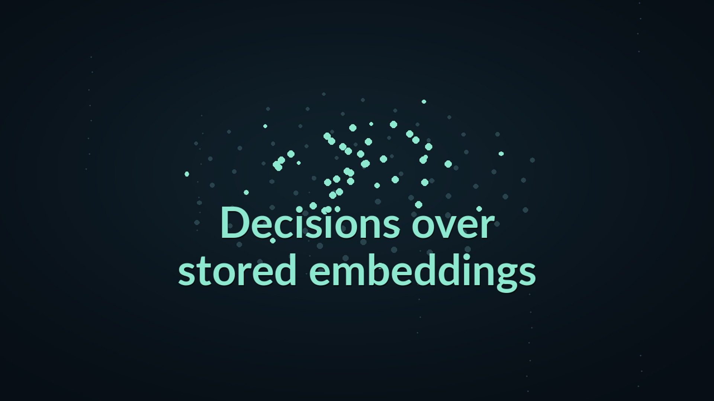

# Venn and Jev: how they differ, and when to use which

<!-- docs-navigation:start -->
[Documentation](README.md) · [Get started](getting-started.md) · [Concepts](concepts.md) · **Venn vs Jev** · [Examples](../examples/README.md) · [Task recipes](cookbooks.md) · [API](api.md) · [Results](evidence.md)

Browse all documentation

**Project home:** [Home](../README.md)

**Start here:** [Documentation overview](README.md) · [Getting started](getting-started.md) · [Installation](installation.md) · [Concepts](concepts.md) · **Venn vs Jev**

**Task guides:** [Task recipes](cookbooks.md) · [Outcome stores](outcome-api.md)

**Examples:** [Choose an example](../examples/README.md) · [Hot dog image classifier](../examples/hotdog/README.md) · [Precedent Desk](../examples/precedent_desk/README.md) · [Wine predictor](../examples/wine/README.md) · [Audio classifier](../examples/audio/README.md) · [Screen-only arena](arena-example.md) · [Demos and videos](demos.md)

**Reference:** [API reference](api.md) · [Design rationale](design.md) · [Venn 1 model card](model-card.md)

**Results and limits:** [Performance and cost](performance.md) · [VennSpace-1](benchmark.md) · [Results and evidence](evidence.md) · [Reproduction](reproduction.md) · [Semantic boundary findings](redteam.md) · [Limitations](limitations.md) · [Comparison video methods](same-memory-video.md) · [Comparison notebooks and renderer](../examples/same_memory_video/README.md)

**Project:** [Policies](policies.md) · [Licenses and attribution](licenses.md) · [Contributing to Venn](../CONTRIBUTING.md)

**Maintainers:** [Maintainer guide](maintainers/maintaining.md) · [Documentation site](maintainers/website.md) · [Release checklist](maintainers/release-checklist.md) · [Publishing the Python package](maintainers/pypi.md) · [Publishing the decision head](maintainers/publishing-the-head.md) · [Development evidence](maintainers/development-evidence.md) · [Comparative evaluation protocol](maintainers/evaluation-plan.md) · [License audit notes](maintainers/license-audit.md)

**Start here / Venn vs Jev**
<!-- docs-navigation:end -->

<!-- docs-contents:start -->

On this page

- [Choose by the work you need to do](#choose-by-the-work-you-need-to-do)
- [A small local decision layer](#a-small-local-decision-layer)
- [The reader can improve independently](#the-reader-can-improve-independently)
- [History supplies answers the item cannot](#history-supplies-answers-the-item-cannot)
- [Your own predictor in one call](#your-own-predictor-in-one-call)
- [Stored vectors keep doing useful work](#stored-vectors-keep-doing-useful-work)
- [Sound carries information that words leave out](#sound-carries-information-that-words-leave-out)
- [Put the choice into practice](#put-the-choice-into-practice)

<!-- docs-contents:end -->

Many applications need a decision, not generated text: which queue owns a
ticket, what score to assign, whether a case deserves a closer look. TypeSafe's
Jev made that pattern practical with typed questions and structured answers.
Venn uses the same question types, but gives an application a different way
to build and reuse the state behind its decisions.

**Jev evaluates the content and context supplied in a request. Venn makes
decisions over embeddings that your application can keep and reuse.** Those
vectors can be matched against described options, compared with historical
cases, or passed through a small predictor trained on your examples.

Venn also keeps the local deployment small: a text embedding reader, a
3.15 MB generic decision head, and task heads that run on CPU. That matters
whether the alternative is a hosted API or an open-source decision model.
The appeal is useful history, reusable state and a small amount of work per
decision.

Watch the 2:30 walkthrough, then use the guide below to choose a workflow.
The [video page](same-memory-video.md) includes captions, the vertical cut
and the examples behind each scene.

## Choose by the work you need to do

| Your starting point | Try first | Why |
| --- | --- | --- |
| Useful category descriptions, few labeled examples, or a changing taxonomy | Jev | It can use a category's description from its first item. |
| A stable set of labels and a useful archive of resolved cases | Venn | References and fitted classifiers learn the labels your team actually uses. |
| Past outcomes and a new case whose outcome you want to predict | Venn | Similar-case lookup and numeric heads turn those outcomes into a prediction. |
| A collection that needs repeated scoring, routing or filtering | Venn | Compatible stored vectors can serve later questions and predictors. |
| Local decisions with a small model and CPU execution | Venn | Load only the text reader, or serve existing vectors without a reader at all. |

Having history does not automatically make Venn the better choice. In our
Firefox bug-routing comparison, Jev selected the right component **64.1%** of
the time, versus **58.3%** for a Venn head trained on past routing. It also
identified grapes from tasting notes more accurately. Conversely, a Venn
classifier's report-only SEC results suggest an advantage from historical
filing labels, but its primary accuracy and useful-answer gates failed.
The examples below show what drives those differences.

Venn also has a generic path that compares an item with described options,
without customer history. History and custom heads are reasons to adopt Venn;
they are not prerequisites for every Venn question.

## A small local decision layer

Running locally is useful only if the system fits the machine and the workload.
Venn's generic decision head has **787,457 parameters**, occupying **3.15 MB**
in float32. Decisions on existing vectors can run on CPU with the reader
unloaded; outcome lookup needs no generic head either.

The reader is designed for compact deployment too. In its
[launch announcement](https://blog.google/innovation-and-ai/technology/developers-tools/embeddinggemma-2/),
Google reports **about 191 MB of active RAM for quantized text-only weights**
on a Pixel 11 Pro, and about 567 MB for the full multimodal model. Text-only
use leaves the vision and audio towers unloaded.

Venn currently loads the 270M-parameter text reader through PyTorch: about
540 MB of weights at 16-bit precision, or 1.08 GB with its default float32 CPU
reader. Google's 191 MB figure describes its quantized deployment, rather
than the current Venn runtime. The [footprint guide](performance.md#model-footprint)
separates those configurations.

That is a smaller model than several language-model-based alternatives. For
example, [Kev](https://github.com/jaredpalmer/kev#models) offers 0.8B, 4B, 9B
and 27B models; [Open JEV](https://github.com/zhihz/openjev) uses Qwen3-4B.
Venn's text reader is about a third the parameter count of Kev-0.8B and a
fifteenth of a 4B model. Other projects also target small CPU deployments,
including [jevos](https://github.com/feder-cr/jev); being local is not unique
to Venn.

The speed advantage comes from the work left after embedding. A fitted linear
head is a small projection; a historical decision searches the vector store.
In the arena example, the compiled action head answered an already embedded
screen in **under half a millisecond**. In the wine price example, fitting and
scoring **65,701 stored vectors took about seven seconds**. Fresh inputs still
pay for embedding. These measurements describe Venn's paths; there is no
matched speed benchmark against the open-source alternatives yet.

## The reader can improve independently

Venn separates the embedding model from the decision layer. As better embedders
become available, an application can feed their vectors into the outcome API
and fit a head from the resulting history. The arena's portable reader already
demonstrates this with a selectable image embedder.

The current `venn-1` generic head and standard text-serving profile are pinned
to EmbeddingGemma 2. Alternative readers are supported today through tagged
vectors in the outcome path, including compiled outcome heads. See
[reader selection](concepts.md#changing-the-reader) for the integration points.

## History supplies answers the item cannot

A complaint can ask for a refund without telling you whether the company will
give one. For that question, similar past outcomes are useful evidence.

In the CFPB comparison, Venn looked up historical complaints to the same
company and used their outcomes to score each new complaint. With nothing
trained, it reached **0.768 AUROC**, versus **0.702** for a method that used
Jev to label the requested outcome, then assigned each label its historical
refund rate. AUROC measures how well a score ranks positive outcomes above
negative ones.

The distinction is easiest to see within refund requests. The label-rate
method gives every request the same score. Venn can distinguish them by
their nearest precedents, which come back with the answer. A model trained on
Jev's answers and historical outcomes did better still, at **0.816**. The
lesson is to use history at the level the decision needs; Venn packages
similar-case evidence into the decision API.

Historical labels can also teach conventions. Software companies commonly
file under SIC group 73, “business services,” although that name says little
about software. On 1,000 additional annual reports, a Venn linear classifier
trained on past filers was right **73.3%** of the time, versus **64.1%** for
Jev. This additional test was report-only: the original 60-filing comparison
failed its accuracy and useful-answer gates. The filing convention helps
interpret the difference; the retail and wholesale breakdown was post hoc.
See the [SEC methods and gate results](same-memory-video.md#sec-show-the-result-and-the-failed-gate).

Use [Precedent Desk](../examples/precedent_desk/README.md) to try classification
from labeled history, or the [outcome-store example](../examples/outcome_store.py)
to choose from recorded outcomes. Lookup returns supporting cases; a fitted
classifier learns from the archive and predicts directly.

## Your own predictor in one call

A team's target may be something a general model was never trained to predict:
its resolution time, its approval outcome, or the score its reviewers assign.
Venn lets the team fit that predictor through `register_family`, using the
same service that answers its other typed questions.

TypeSafe's wine cookbook illustrates a different route. A language model
proposes questions, Jev answers them for every note, and CatBoost learns to
predict the critic's score from those answers. The process repeats over
several rounds.

A Venn head learned from the same 1,200 scored tasting notes in one registration
call. On 3,000 fresh notes, its error was **1.803 critic points**, versus
**1.794** for the five-round, 38-question Jev pipeline. The practical result
is similar accuracy with much less application machinery: no question-discovery
loop and no separate modeling library to integrate.

Run [the wine example](../examples/wine/README.md) with `--form kernel_ridge`
to fit this configuration, or use its default ridge model as a simpler baseline.
The script keeps fitting and evaluation notes separate and reports the result.
The [numeric-family recipe](cookbooks.md#fit-a-numeric-family) shows the API call.

## Stored vectors keep doing useful work

A representation becomes more valuable when several decisions use it. A support
archive might need routing today, a new topic classification next week, and a
backlog sweep after a policy changes. Venn exposes the vectors so the
application can keep them, register new predictors and apply questions across
the collection.

In the wine price comparison, a Venn head reached **0.538 log-price error**,
close to **0.531** for Jev asked directly. Fitting and applying the head over
65,701 already embedded notes took about **7 seconds**. This is the useful
operating pattern: pay for the representation, then put it to work repeatedly.

Reuse depends on the representation the task needs. The wine score head uses
SentenceSimilarity embeddings and note lengths; the price head uses
Classification embeddings. Those are separate caches. A new task may also
need labeled examples before a useful predictor can be fitted.

Jev can answer several questions in one request, sharing the supplied input.
Its API returns decisions rather than embeddings. It does not offer a path
for applying later questions or custom heads to your stored embedding history.
You can supply retrieved historical context as content in a Jev request;
Venn works directly with the stored vectors and outcomes.

See [index streaming](cookbooks.md#register-stream-and-delete-an-index) for a
collection workflow and [performance](performance.md) for where the work goes.

## Sound carries information that words leave out

Jev supports text and images, but not audio or video. Venn's experimental
media paths let an application keep image and audio embeddings and use the
same history and head mechanisms on them. Images alone are therefore not the
distinction; reusable representations and recorded experience are.

In CREMA-D, actors read identical sentences in different emotions. Jev,
given the transcripts, scored **14.6%** emotion accuracy. A Venn linear head
on the audio vectors scored **56.5%** for speakers held out of training.
The words cannot distinguish those performances; the sound can.

The [audio example](../examples/audio/README.md) fits a head from labeled WAV
clips. The [arena example](arena-example.md) shows the corresponding history
loop for images: embed a screenshot, choose from similar past moments, record
the outcome, and eventually compile the memory into an action head.
TypeSafe lists its current [supported inputs](https://docs.typesafe.ai/models)
and [response interface](https://docs.typesafe.ai/api/system-one).

## Put the choice into practice

Start with Jev when category descriptions and the supplied content are your
best source of information. Start with Venn when you have useful labeled
history, want to fit your own predictor, or expect to keep asking questions of
the same embedded collection. For a mixed workload, Venn can handle established
cases while Jev or a person handles unfamiliar ones.

The value of Venn is in bringing these workflows together: typed questions,
lookup with supporting cases, custom predictors and collection operations,
with a frozen reader underneath. The [examples](../examples/README.md) are
the quickest way to try the relevant path. The [evidence ledger](evidence.md)
collects the results, timings and source material; the
[comparison video](same-memory-video.md) illustrates the workflows.

<!-- docs-pager:start -->
---

[← Previous: Concepts](concepts.md) · [Next: Task recipes →](cookbooks.md) · [Documentation home](README.md)
<!-- docs-pager:end -->
