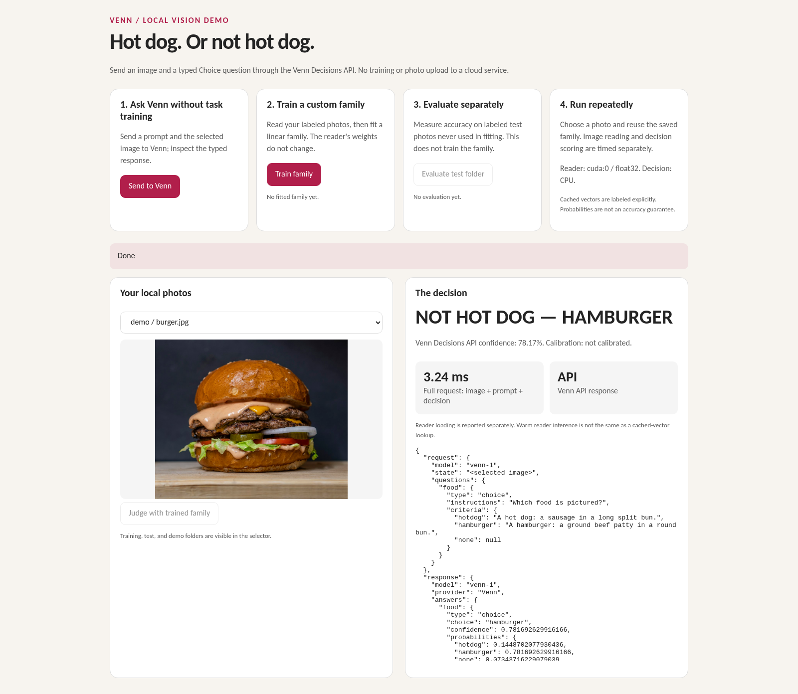

# Hot dog or not hot dog

<!-- docs-navigation:start -->
[Documentation](../../docs/README.md) · [Get started](../../docs/getting-started.md) · [Concepts](../../docs/concepts.md) · [Venn vs Jev](../../docs/venn-and-jev.md) · [Examples](../README.md) · [Task recipes](../../docs/cookbooks.md) · [API](../../docs/api.md) · [Results](../../docs/evidence.md)

<details>
<summary>Browse all documentation</summary>

**Project home:** [Home](../../README.md)

**Start here:** [Documentation overview](../../docs/README.md) · [Getting started](../../docs/getting-started.md) · [Installation](../../docs/installation.md) · [Concepts](../../docs/concepts.md) · [Venn vs Jev](../../docs/venn-and-jev.md)

**Task guides:** [Task recipes](../../docs/cookbooks.md) · [Outcome stores](../../docs/outcome-api.md)

**Examples:** [Choose an example](../README.md) · **Hot dog image classifier** · [Precedent Desk](../precedent_desk/README.md) · [Wine predictor](../wine/README.md) · [Audio classifier](../audio/README.md) · [Screen-only arena](../../docs/arena-example.md) · [Demos and videos](../../docs/demos.md)

**Reference:** [API reference](../../docs/api.md) · [Design rationale](../../docs/design.md) · [Venn 1 model card](../../docs/model-card.md)

**Results and limits:** [Performance and cost](../../docs/performance.md) · [VennSpace-1](../../docs/benchmark.md) · [Results and evidence](../../docs/evidence.md) · [Reproduction](../../docs/reproduction.md) · [Semantic boundary findings](../../docs/redteam.md) · [Limitations](../../docs/limitations.md) · [Comparison video methods](../../docs/same-memory-video.md) · [Comparison notebooks and renderer](../same_memory_video/README.md)

**Project:** [Policies](../../docs/policies.md) · [Licenses and attribution](../../docs/licenses.md) · [Contributing to Venn](../../CONTRIBUTING.md)

**Maintainers:** [Maintainer guide](../../docs/maintainers/maintaining.md) · [Documentation site](../../docs/maintainers/website.md) · [Release checklist](../../docs/maintainers/release-checklist.md) · [Publishing the Python package](../../docs/maintainers/pypi.md) · [Publishing the decision head](../../docs/maintainers/publishing-the-head.md) · [Development evidence](../../docs/maintainers/development-evidence.md) · [Comparative evaluation protocol](../../docs/maintainers/evaluation-plan.md) · [License audit notes](../../docs/maintainers/license-audit.md)

</details>

**Examples / Hot dog image classifier**
<!-- docs-navigation:end -->

<!-- docs-contents:start -->
<details>
<summary>On this page</summary>

- [Setup](#setup)
- [What to show](#what-to-show)
- [Related examples and concepts](#related-examples-and-concepts)

</details>
<!-- docs-contents:end -->

A local visual demo inspired by Silicon Valley. Supply your own photos; this
sample downloads no food dataset. Training photos and local model state are
git-ignored; the documentation screenshot below includes an illustrative burger photo.



*The screenshot shows the Venn Decisions API request and response for a burger.
No task-specific family was trained for this judgment.*

**Investigation: the screenshot exposes a dataset mistake.** The demonstration
used 40 photos per class from the D2L archive, whose negative images inspected
here are bananas. A classifier fitted to hot dogs versus bananas does not learn
the intended boundary between hot dogs and other foods. Its 20/20 result on
similarly narrow test data was misleading. A seeded random run with 400 training
and 200 test images reproduced the same confident burger mistake.

The screenshot shows a Venn Decisions API Choice request and response. The
request sends the image, asks “Which food is pictured?”, and describes hot dog
and hamburger options. The returned answer is `hamburger` at 78.17% confidence;
the model is not calibrated. This is the trained generic Venn decision head
working over Gemma's image embedding, with no task-specific family fitting.

The separate embedding comparison is also useful for understanding the result:
the image is closer to the hamburger description (0.705) than the hot-dog
description (0.674). Those cosine similarities are not the API's confidence
scores. The earlier task-family mistake came from banana-only negatives.

[Recorded result and investigation](../../docs/media/hotdog-burger-result.json).
Training images are not redistributed.
Burger photo: [Unsplash source](https://images.unsplash.com/photo-1568901346375-23c9450c58cd),
used under the [Unsplash License](https://unsplash.com/license). The original
is 4338 × 3604 pixels, above Venn's image limits (at most 4 million pixels and
6 MB per image), so download the
[1080-pixel-wide copy](https://images.unsplash.com/photo-1568901346375-23c9450c58cd?w=1080)
to try it yourself. Resize larger photos before sending them.

## Setup

Start with [installation](../../docs/installation.md) if Venn is not installed.
Use [getting started](../../docs/getting-started.md) for a first download-free
result before setting up the image reader.

Install `.[embedding,dev]` (family fitting needs scikit-learn) and run
`venn download-embedder`. Create `examples/hotdog/photos/` with this layout:

```text
photos/
  train/hotdog/       at least five distinct photos; more is better
  train/not_hotdog/   other foods and tricky negatives
  test/hotdog/        unseen photos, not copies of training photos
  test/not_hotdog/    unseen negative photos
  demo/              unlabeled photos to judge on screen
```

From the repository root on Linux, run:

```bash
python examples/hotdog/hotdog.py --serve --device cpu
# Open http://127.0.0.1:8011
```

On Windows PowerShell:

```powershell
.\.venv\Scripts\python.exe examples\hotdog\hotdog.py --serve --device cpu
# Open http://127.0.0.1:8011
```

Use `--device cuda:0` on a supported CUDA installation; omit it to use CPU. `--data` selects another photo folder;
`--state` selects another cache and saved-family folder. The default head is
downloaded on startup; `--model-dir` uses existing assets. The pinned reader
must already be downloaded. The web server binds only to localhost and has no
authentication; do not expose it to a network.

## What to show

**Train family** first embeds labeled training photos with the frozen
EmbeddingGemma reader, then fits a small linear Venn Choice family. It reports
reader loading, image embedding, cache hits, and family fitting separately.
Cross-validation uses training photos only. The family persists across restarts;
judging does not retrain it.

**Evaluate test folder** reports correct/total on unseen labeled photos.
Exact duplicate files and train/test overlap are rejected. Different crops of
the same original should also be kept in one split by the person providing
photos. A small test set is not a general accuracy claim.

**Judge this photo** shows the photo, verdict, probabilities, reader/cache time,
and decision-only time. The reader uses CPU or GPU float32; the family scorer
runs on CPU. A bare sausage can still fool this model: include such negatives
in training, reserve others for testing, and show mistakes honestly.
Probabilities may be uncalibrated.

For clean measurements, use a new `--state` folder (rather than deleting one)
and run one device at a time. First-image timing includes cold reader loading
reported separately. After reader warm-up, judge a new photo to measure fresh
embedding; judge it again to measure cached-vector lookup. Neither is the same
as decision-only latency. HTTP, browser rendering, downloads, and service
startup are outside the displayed per-stage timers.

The same actions work without a browser:

```powershell
.\.venv\Scripts\python.exe examples\hotdog\hotdog.py --action train --device cuda:0
.\.venv\Scripts\python.exe examples\hotdog\hotdog.py --action evaluate --device cuda:0
.\.venv\Scripts\python.exe examples\hotdog\hotdog.py --action judge --image lunch.jpg --device cuda:0
```


## Related examples and concepts

- [Linear-family recipe](../../docs/cookbooks.md#fit-a-linear-choice-family): the fitting API used here.
- [Audio classifier](../audio/README.md): the same classifier workflow with labeled WAV clips.
- [Wine predictor](../wine/README.md): numeric prediction through a regression family.
- [Screen-only arena](../../docs/arena-example.md): learning from recorded outcomes and compiling memory into a head.
- [Demos and videos](../../docs/demos.md): choose another demonstration.

<!-- docs-pager:start -->
---

[← Previous: Choose an example](../README.md) · [Next: Precedent Desk →](../precedent_desk/README.md) · [Documentation home](../../docs/README.md)
<!-- docs-pager:end -->
